<div align="center">

# OmniAgent

**Multi-Modal Autonomous AI Engineering Workbench & Workflow Copilot**

[](https://github.com)
[](https://www.vultr.com/)
[](https://www.typescriptlang.org/)
[](https://react.dev/)
[](https://expressjs.com/)
[](https://ai.google.dev/)

*Turn fragmented codebases, telemetry spreadsheets, PDFs, audio notes, and architecture wireframes into verified patches, SQL migrations, execution blueprints, and staged webhook automations.*

[Overview](#overview) · [Problem It Solves](#problem-it-solves) · [Architecture](#architecture-diagram) · [Vultr Integration](#vultr-cloud--object-storage-integration) · [Key Features](#key-features) · [Setup](#setup-steps) · [API Reference](#api-endpoints)

</div>

---

OmniAgent is a multimodal AI engineering workbench that helps teams analyze uploaded technical artifacts, ask engineering questions grounded in local file context, and turn them into structured execution plans and automation actions. It combines a local artifact sandbox, vector search, Gemini-powered reasoning, and **Vultr Cloud Compute + Vultr Object Storage** deployment readiness into one interface for technical troubleshooting and workflow generation.

> [!IMPORTANT]
> **Built for Action, Not Passive Q&A:** Unlike standard chat wrappers, OmniAgent ingests multiple technical formats simultaneously, grounds every answer in line-numbered vector chunks and native visual/audio context, executes multi-round server-side tool calls, and stages downloadable scripts and inspectable webhook payloads—with direct S3-compatible **Vultr Object Storage** upload support.

---

## Overview

This project is a TypeScript-based app built with React, Vite, and Express. It allows users to upload documents, code, spreadsheets, PDFs, images, and audio into a private sandbox, then query that content through a streaming agent. The system stores indexed chunks, retrieves the most relevant context, and uses Gemini to produce deep technical responses, execution blueprints, and staged automation hooks.

| Capability Layer | Implementation |
| :--- | :--- |
| **Reasoning Engine** | `gemini-4-hydrogen` (`Standard` / `HIGH` & `Deep Reasoning` / `XHIGH`) with automatic `gemini-3.1-flash-lite` rate-limit failover |
| **Vector Indexing & RAG** | `gemini-embedding-2` cosine-similarity search across isolated session sandboxes with local lexical fallback |
| **Multi-Modal Parsing** | Code (`.py`, `.ts`, `.js`, `.cpp`, `.sql`), Docs (`.pdf`, `.md`), Spreadsheets (`.csv`, `.xlsx`), Images (`.png`, `.jpg`), Audio (`.mp3`, `.wav`) |
| **Streaming & Tooling** | Server-Sent Events (`POST /api/agent/stream`) driving 4 server-side Gemini Function Calling tools |
| **Vultr Cloud & Storage** | Production `Dockerfile`, Vultr Cloud Compute provisioning (`deploy/vultr-setup.sh`), SSE-tuned Nginx (`deploy/vultr-nginx.conf`), and S3 SigV4 `server/vultrStorage.ts` client |
| **Privacy & Validation** | Ephemeral in-memory session isolation, magic-byte file verification, 20 MB cap, and one-click sandbox purge |

---

## Problem it solves

Most engineering teams work across fragmented artifacts: specs, diagrams, logs, CSV data, source code, and meeting notes. Those files often live in different places and are difficult to reason about together. OmniAgent solves this by creating a single secure workspace where artifacts can be ingested, semantically searched, and analyzed with AI in context.

Instead of giving shallow summaries, the app is designed to produce actionable outputs such as:

- architecture and bottleneck analysis
- execution plans with steps and effort estimates
- code or workflow suggestions grounded in uploaded files
- webhook automation staging and **Vultr Object Storage** artifact publishing
- session-based technical audit reports

---

## How it works

1. Users upload files into the sandbox (or load the 4-modality HackGlobal sample bundle in one click).
2. The server ingests and validates each artifact (magic-byte checks, binary corruption guards, and `xlsx` schema inference).
3. Text and structured content are chunked with line ranges (`L1-L28`) and indexed into `gemini-embedding-2` vectors for retrieval.
4. The app runs a semantic vector search against the current session index (`topK = 12`) plus deep full-chunk context assembly.
5. Relevant matches, all indexed chunks, and native `inlineData` binaries (images, PDFs, audio) are sent to the Gemini model alongside the user prompt.
6. The AI responds with streamed reasoning, execution traces, plans, and action suggestions via Server-Sent Events (SSE).
7. Generated execution plans and automation hooks are stored inside the session state for inspection, script download, and sandbox or live **Vultr Object Storage** dispatch.

The application exposes a session-based API for:

- artifact upload and ingestion
- session reset and cleanup
- vector-based retrieval
- execution plan updates
- webhook dispatch simulation or live **Vultr Object Storage** S3 upload
- SSE-based streaming chat interactions

---

## Architecture diagram

### Interactive System Flow

```mermaid
flowchart LR
    U["Operator / Browser<br/>3-Pane React + Vite UI"] -->|Multipart Upload & SSE| NX["Vultr Cloud Compute<br/>Nginx SSE Proxy - Port 80 and 443"]
    NX --> API["Express API Server<br/>server.ts - Port 3000"]
    API --> ING["Multi-Modal Ingestion<br/>Validation, Chunking, XLSX"]
    ING --> VEC["Local Vector Sandbox<br/>gemini-embedding-2 + Lexical Fallback"]
    API --> GEM["Hybrid Reasoning Layer<br/>gemini-4-hydrogen - HIGH and XHIGH"]
    VEC -->|Top-K Cosine Matches| GEM
    GEM <-->|Function Calling Loop| TOOLS["Agentic Tools<br/>Vector Search, Schema, Plans, Webhooks"]
    TOOLS -->|SigV4 Storage Dispatch| VOS["Vultr Object Storage<br/>S3-Compatible Bucket"]
    TOOLS -->|SSE Stream| U
```



### Component Topology

```text
+-------------------+      +--------------------------+
| User / Browser    | ---> | Vultr Cloud Compute      |
|                   |      | Nginx SSE Reverse Proxy  |
+-------------------+      +------------+-------------+
                                        |
                                        v
                           +--------------------------+
                           | Express + React/Vite App |
                           | /api/* endpoints (:3000) |
                           +------------+-------------+
                                        |
           +----------------------------+----------------------------+
           |                            |                            |
           v                            v                            v
+-------------------+      +---------------------+      +----------------------+
| Artifact Sandbox  |      | Vector Index / RAG  |      | Gemini API           |
| File validation   |      | semantic retrieval  |      | reasoning + tools    |
| chunking + logs   |      | session search      |      +----------------------+
+-------------------+      +---------------------+                   |
                                        |                            |
                                        v                            v
                           +---------------------+      +----------------------+
                           | Execution Plans /   | ---> | Vultr Object Storage |
                           | Webhook Actions     |      | S3 SigV4 Upload      |
                           +---------------------+      +----------------------+
```

---

## Vultr Cloud & Object Storage Integration

OmniAgent is engineered for clean, reproducible deployment and storage integration on **Vultr**:

1. **Vultr Cloud Compute Provisioning (`deploy/vultr-setup.sh`)**:
   - Automates Ubuntu 24.04 LTS setup with Node.js 22, dependency installation, production frontend build (`vite build`), `systemd` process management (`omniagent.service`), and Nginx activation.
2. **SSE-Tuned Nginx Reverse Proxy (`deploy/vultr-nginx.conf`)**:
   - Configures `proxy_buffering off`, `proxy_cache off`, `chunked_transfer_encoding on`, and a `300s` read timeout on `/api/agent/stream` so token-by-token Gemini reasoning streams with zero buffering lag, alongside `client_max_body_size 25M` for multi-modal uploads.
3. **Containerized Deployment (`Dockerfile`)**:
   - Multi-stage `node:22-alpine` image ready for **Vultr Container Registry (VCR)**, **Vultr Kubernetes Engine (VKE)**, or Docker on **Vultr Cloud Compute**.
4. **Live Vultr Object Storage Webhook Client (`server/vultrStorage.ts`)**:
   - Implements a zero-dependency AWS Signature Version 4 (SigV4) S3 uploader using Node's native `crypto` module.
   - When `VULTR_OBJECT_STORAGE_*` credentials are set in `.env`, clicking **Dispatch Hook** on any staged `storage` automation uploads the generated script or JSON audit manifest directly to your **Vultr Object Storage** bucket and returns the live object URL receipt (falling back cleanly to local sandbox simulation when unconfigured).

### Deploying on Vultr

```bash
# 1. On a Vultr Cloud Compute (Ubuntu 24.04) instance:
git clone <your-repo-url> && cd <repo-dir>
cp .env.example .env
# Add GEMINI_API_KEY and optional VULTR_OBJECT_STORAGE_* credentials in .env

# 2. Run the automated Vultr + Nginx + systemd setup:
chmod +x deploy/vultr-setup.sh
./deploy/vultr-setup.sh
```

Or deploy via Docker / **Vultr Container Registry**:

```bash
docker build -t omniagent:latest .
docker run -d -p 3000:3000 --env-file .env --name omniagent omniagent:latest
```

---

## Key features

- **Multi-Format Artifact Ingestion**: Drag-and-drop support for source code, PDFs, Markdown, CSV/Excel spreadsheets (with automatic column type inference and null counts), PNG/JPG wireframes, and audio notes.
- **Corrupt-File & Security Guards**: Rejects 0-byte files, >20 MB payloads, disguised binary null-bytes, and invalid `%PDF-` / PNG / JPEG headers with clear diagnostics.
- **Local Session Sandbox**: Ephemeral session-scoped memory with real-time execution logs (`INGESTION`, `EMBEDDING`, `RAG_RETRIEVAL`, `REASONING`, `TOOL_CALL`, `WEBHOOK_HOOK`, `SYNTHESIS`, `SECURITY`).
- **Semantic Vector Retrieval & Explorer**: Uses `gemini-embedding-2` cosine similarity with automatic lexical fallback and a live **Vectors** search tab to query indexed chunks directly.
- **Streaming Hybrid Reasoning**: Powered by `gemini-4-hydrogen` over SSE with selectable `Standard` and `Deep Reasoning` thinking depths, plus automatic `429` retry backoff and `gemini-3.1-flash-lite` failover.
- **Autonomous Tool Calling**:
  - `search_vector_index` — cross-file semantic retrieval
  - `analyze_tabular_schema` — spreadsheet column type and anomaly inspection
  - `generate_execution_plan` — structured multi-phase engineering blueprints
  - `dispatch_webhook_action` — staged `git`, `cicd`, `storage`, `tasks`, and `database` payloads with runnable scripts
- **Staged Webhook Action Handling & Vultr Object Storage Export**: Copy JSON payloads, download generated scripts/configs, and dispatch hooks inside the sandbox or directly to a **Vultr Object Storage** bucket.
- **One-Click HackGlobal Sample Bundle**: Pre-loads a FastAPI service with N+1 & SQL injection bottlenecks (`order_service.py`), endpoint telemetry (`latency_telemetry.csv`), sprint spec (`architecture_spec.md`), and topology diagram (`service_topology_wireframe.png`).
- **Dual-Theme 3-Pane Workbench**: Light & Dark mode support, GFM markdown rendering with copy/save code blocks, collapsible reasoning traces, RAG similarity citations, and one-click `Reset Sandbox` memory purge.

---

## Setup steps

1. Install dependencies:

```bash
npm install
```

2. Create environment variables from `.env.example`:

```bash
cp .env.example .env
```

3. Add your Gemini key (and optional Vultr Object Storage settings) in `.env`:

```env
GEMINI_API_KEY="your_gemini_api_key"
APP_URL="http://localhost:3000"

# Optional: Vultr Object Storage (S3-compatible)
VULTR_OBJECT_STORAGE_ENDPOINT="ewr1.vultrobjects.com"
VULTR_OBJECT_STORAGE_BUCKET="omniagent-artifacts"
VULTR_OBJECT_STORAGE_ACCESS_KEY=""
VULTR_OBJECT_STORAGE_SECRET_KEY=""
```

4. Start the app:

```bash
npm run dev
```

5. Open the local app at the URL shown by the server (default is usually `http://localhost:3000`).

---

## Production build

```bash
npm run build
npm run start
```

---

## Tech stack

- **Frontend**: React 19, TypeScript, Vite, Tailwind CSS v4, Lucide React
- **Markdown & Rendering**: `react-markdown`, `remark-gfm`
- **Backend**: Express, Node.js (`tsx` in dev)
- **Cloud & Storage**: Vultr Cloud Compute, Nginx SSE Reverse Proxy, Docker, Vultr Object Storage (S3-compatible SigV4)
- **AI & Embeddings**: Google Gemini API (`@google/genai` — `gemini-4-hydrogen`, `gemini-3.1-flash-lite`, `gemini-embedding-2`)
- **File & Data Parsing**: `multer` (multipart uploads), `xlsx` (CSV/TSV/Excel parsing)

---

## API endpoints

<details>
<summary><strong>View all 10 REST & SSE backend endpoints</strong></summary>

| Method | Endpoint | Purpose |
| :--- | :--- | :--- |
| `GET` | `/api/health` | Server healthcheck (`200 OK`) |
| `GET` | `/api/session/:sessionId` | Fetch session artifacts, execution logs, plans, actions, and vector stats |
| `POST` | `/api/session/:sessionId/purge` | Purge all artifacts, vectors, plans, and actions from sandbox memory |
| `POST` | `/api/session/:sessionId/upload` | Ingest, validate, chunk, and embed up to 12 multimodal files |
| `POST` | `/api/session/:sessionId/load-sample` | Load and index the 4-modality HackGlobal sample engineering bundle |
| `DELETE` | `/api/session/:sessionId/artifacts/:artifactId` | Remove an individual artifact and its vector chunks |
| `GET` | `/api/session/:sessionId/artifacts/:artifactId/preview` | Inspect full parsed text, spreadsheet schema/rows, or image preview |
| `POST` | `/api/session/:sessionId/search` | Execute direct cosine/lexical search against the session vector store |
| `POST` | `/api/session/:sessionId/actions/:actionId/dispatch` | Dispatch a staged webhook hook (uploads `storage` hooks to Vultr Object Storage when configured) |
| `POST` | `/api/agent/stream` | SSE stream combining RAG retrieval, multi-round tool calls, and Markdown synthesis |

</details>

---

## Project structure

```text
├── Dockerfile                         # Production Node 22 container for Vultr Cloud / VCR
├── deploy/
│   ├── vultr-nginx.conf               # SSE-tuned Nginx proxy for Vultr Cloud Compute
│   └── vultr-setup.sh                 # Ubuntu 24.04 Vultr instance setup & systemd script
├── server.ts                          # Express + Vite dev/prod server & SSE orchestration
├── server/
│   ├── agentTools.ts                  # Gemini FunctionDeclarations & sandbox tool handlers
│   ├── geminiClient.ts                # Server-side @google/genai client, retry & error formatting
│   ├── ingestion.ts                   # Multi-modal parser, magic-byte validation, xlsx & chunking
│   ├── rag.ts                         # Session-isolated vector store & cosine/lexical search
│   ├── sampleBundles.ts               # Built-in 4-modality HackGlobal engineering sample bundle
│   └── vultrStorage.ts                # S3-compatible AWS SigV4 client for Vultr Object Storage
├── src/
│   ├── App.tsx                        # 3-pane workbench state, SSE stream parser & theme sync
│   ├── index.css                      # Tailwind v4 configuration & typography variables
│   ├── types/omniagent.ts             # Shared TypeScript interfaces
│   └── components/
│       ├── TopBar.tsx                 # 3-zone navigation header & Reset Sandbox trigger
│       ├── IngestionPanel.tsx         # Left sidebar: drag-and-drop uploader & vector stats
│       ├── ChatWorkspace.tsx          # Center stream: reasoning toggle, traces, RAG & composer
│       ├── ExecutionSidebar.tsx       # Right sidebar: Logs, Actions & Vector Explorer tabs
│       ├── MarkdownRenderer.tsx       # GFM markdown, tabular figures & copy/save code blocks
│       ├── ArtifactPreviewModal.tsx   # Code, spreadsheet & wireframe inspection modal
│       └── PrivacyModal.tsx           # Local sandbox security summary & memory purge dialog
```

---

## Credits

This project uses the following technologies and services:

- Google Gemini for LLM reasoning and embedding workflows
- Vultr Cloud Compute & Vultr Object Storage for cloud deployment and artifact storage integration
- Vite for frontend tooling
- React for the user interface
- Express for the backend API and file-serving layer
- Tailwind CSS for styling
- Node.js and TypeScript for the application runtime

---

## Notes

The repository is configured as a deployable TypeScript app and is intended for AI-assisted engineering analysis and automation tasks. The app emphasizes grounded, artifact-aware responses rather than generic chat output, which makes it useful for technical audits, architecture work, and workflow planning.
